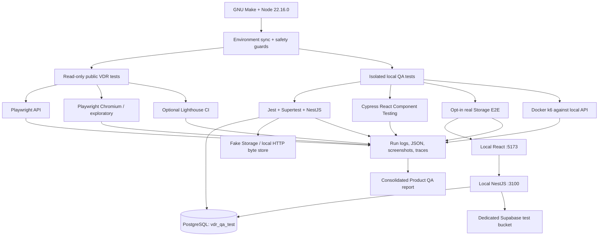
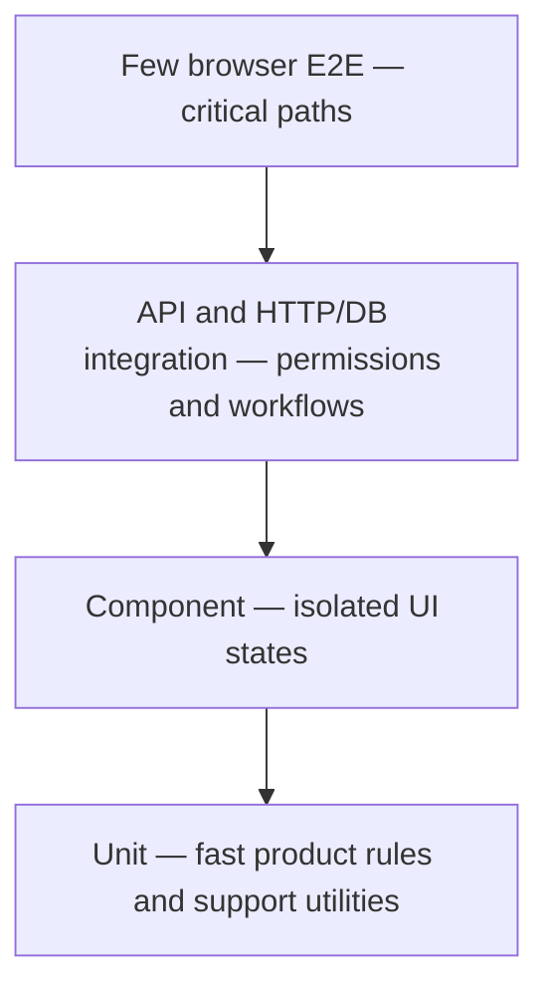
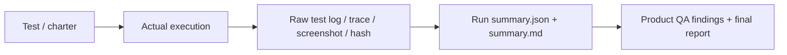

# Virtual Data Room — Product QA & Automation Framework

> **Product QA practical assignment** · [Original VDR](https://github.com/evo9/virtual-data-room) · [Product requirements](virtual-data-room-main/task.md) · [Submission index](SUBMISSION/README.md)

This repository contains a **risk-based QA assessment** of an existing Virtual Data Room (VDR) and the beginning of a **reusable automation framework**. The primary objective is to evaluate product behavior and communicate defects, risks, and untested requirements—not to maximize the number of automated checks.

**Start with the assignment deliverables:** [Test Plan](SUBMISSION/01_TEST_PLAN.md) · [Prioritized Findings](SUBMISSION/02_PRIORITIZED_FINDINGS.md) · [Testing Approach](SUBMISSION/03_TESTING_APPROACH.md) · [Final QA Report](SUBMISSION/04_FINAL_QA_REPORT.md) · [Evidence & Limitations](SUBMISSION/06_EVIDENCE_AND_LIMITATIONS.md) · [AI Disclosure](SUBMISSION/05_AI_DISCLOSURE.md).

## 1. Scope and ownership

- **System under test (SUT):** React/Vite frontend, NestJS backend, Prisma/PostgreSQL, and Supabase Storage. `virtual-data-room-main/` contains the application's source; its pre-existing backend unit tests are **not presented as QA-authored work**.
- **QA additions:** API and browser tests, Cypress component tests, NestJS HTTP/database integration scenarios, a byte-level PDF lifecycle test, infrastructure checks, safety guards, exploratory charters, performance/accessibility tooling, and evidence reporting.
- **Priority areas:** private document access, USER/PUBLIC_LINK sharing and revocation, PDF integrity, folder/file operations and deletion, validation, and error recovery. These reflect VDR confidentiality and the original product requirements.
- **Excluded assumptions:** optional search/versioning are not mandatory failures; a mocked Storage check does not prove real Supabase behavior; a reported risk is not automatically a confirmed defect.

## 2. Architecture



There are **two intentionally separate execution boundaries**:

1. **Public demo — read-only:** login, GET/API contract checks, navigation, error presentation, PDF preview/download, and bounded Lighthouse audits. No uploads, share creation, account creation, destructive operations, or load tests are permitted against shared demo data by default.
2. **Disposable local QA stack — stateful:** real NestJS controllers, Prisma and `vdr_qa_test` PostgreSQL. Most integration scenarios replace external Storage to keep tests deterministic; the separate guarded browser E2E uses a **dedicated** Supabase bucket to validate actual signed upload/download integration.

### Why these technologies?

| Layer | Tools / location | Rationale and trade-off |
|---|---|---|
| Existing product unit tests | Jest, `virtual-data-room-main/apps/api/src/**/*.spec.ts` | Fast baseline for pre-existing business behavior. Authored by the product repository, not this QA submission. |
| Component | Cypress + React/Vite, `apps/web/cypress/component/` | Exercise **real** `PdfViewer` and `UploadPanel` rendering, progress, retry, pending/error states without fragile full-system setup. Mocked network/hooks mean these checks do **not** validate backend/Storage integration. |
| HTTP + database integration | Jest + Supertest + NestJS + Prisma + dedicated PostgreSQL, `apps/api/test/qa-*.int-spec.ts` | Real validation pipes, guards, services, HTTP routes, queries, and DB constraints; deterministic synthetic users and cleanup. Storage is a fake for speed and failure injection. |
| API contract / security smoke | Playwright API request, `vdr-qa-starter/tests/api/` | Reuse credentials and resource discovery; cover authentication, paginated reads, anonymous denial and invalid public tokens. Read-only against public demo. |
| Browser journeys / exploratory | Playwright Chromium, `vdr-qa-starter/tests/ui/` | User-observable journeys, accessibility-oriented selectors, screenshots and traces; intentionally few browser tests to reduce flakiness. |
| Real PDF lifecycle | Guarded Playwright E2E + **isolated** Supabase | Crosses React → NestJS → signed Storage upload → download → SHA-256, then rename/move/delete and records post-revoke signed-URL behavior. Opt-in only; cannot be inferred from local fake-Storage PASS. |
| Non-functional and tooling | Docker k6, Lighthouse CI, optional ScanRepo | Local bounded performance evidence, route audits and heuristic repository review. They do **not** prove correctness, WCAG compliance or security by themselves. |

**Why not two full browser E2E stacks?** Playwright owns browser journeys/API checks; Cypress is limited to component testing, avoiding duplicated high-maintenance E2E suites. **Why not an entirely mocked backend?** HTTP/DB integration deliberately uses real NestJS + PostgreSQL so permission and persistence behavior is not replaced by test stubs.

### Testing pyramid



The levels are a **coverage strategy, not a fixed test-count ratio**. Unit checks of the QA framework itself (bootstrap, guards, reporting) are tracked as *tooling validation*, not VDR product tests. Known-defect reproductions are separated from passing acceptance checks.

## 3. Repository layout

```text
.
├── README.md                              # Architecture, rationale, and entry point
├── Makefile                              # Standard commands; test/environment orchestration
├── .nvmrc                                # Node.js 22.16.0
├── .env.example                          # Safe root configuration template
├── scripts/
│   ├── sync-env.mjs                      # Root .env → isolated generated QA env files
│   ├── qa-doctor.mjs                     # Configuration diagnostics (no secret output)
│   ├── qa-evidence.mjs                   # Executes selected suites and captures results
│   └── qa-report.mjs                     # Builds consolidated product QA report
├── virtual-data-room-main/              # Original SUT + QA-specific test additions
│   ├── task.md                           # Original product requirements
│   ├── apps/api/test/qa-support/harness.ts
│   ├── apps/api/test/qa-*.int-spec.ts    # NestJS + PostgreSQL integration tests
│   ├── apps/api/test/qa-known-*.ts       # Separate known-defect reproduction
│   ├── apps/web/cypress/component/       # PdfViewer / UploadPanel component tests
│   └── qa/docker-compose.postgres.yml    # Disposable local test database
├── vdr-qa-starter/
│   ├── playwright.config.ts              # API / Chromium projects; mutation isolation
│   ├── tests/api/                        # Playwright read-only API checks
│   ├── tests/ui/                         # UI, exploratory, guarded Storage E2E
│   ├── tests/unit/                       # QA framework/guard self-tests
│   ├── scripts/                          # Discovery, Storage guard, k6 and Lighthouse runners
│   ├── performance/k6/                   # Load profiles and report scripts
│   └── lighthouse/                       # Lighthouse auth, routes, verification
├── SUBMISSION/                           # The five requested deliverables + evidence
├── evidence/                             # Historical/isolated proof, labeled by provenance
└── reports/                              # GENERATED by local runs; inspect before sharing
```

The test code lives **next to its most relevant integration boundary**: product-level NestJS and React tests stay under the app tree, while cross-system Playwright/k6/Lighthouse helpers stay in `vdr-qa-starter`. This permits extension without copying setup/cleanup or scattering credentials.

## 4. Quick start (Ubuntu + Docker)

Prerequisites: Bash, GNU Make, Docker Engine/Compose, and nvm. `make setup` runs in user mode; it **does not install OS packages or run sudo**. System libraries for Chromium may require manual installation on a fresh Ubuntu host.

```bash
cp .env.example .env         # one time; add approved test credentials, do not commit
make setup                   # Node 22.16 + npm ci + Chromium/FFmpeg + Cypress + Docker k6
make qa-doctor               # validates local targets and QA configuration
make postgres-up             # isolated vdr_qa_test
make db-prepare              # safety guard, Prisma generate and migrations
make qa-evidence-local       # upstream Jest, integration, component, tooling + known findings
make qa-final-readonly       # public read-only API and browser/exploratory checks
make qa-report               # reports/product-qa/latest.md
```

`make setup` calls `make env-sync`. It creates/refreshes six local config files from the root `.env` (`vdr-qa-starter/.env`, `apps/api/test/.env.test`, `.env.k6`, `.env.browser`, `vdr-qa-starter/.env.storage`, and `apps/web/.env.local`). Generated secrets are untracked and written with `0600` permissions. **Root production DB credentials and generic Supabase service-role keys are deliberately not copied into destructive QA tests.** `CHROME_PATH` and `CHROMIUM_EXECUTABLE_PATH` are automatically derived from the installed Playwright browser by Make wrappers.

Use `make help` for the complete command list. Common targeted commands:

| Command | Purpose |
|---|---|
| `make test-product-unit` | Original backend Jest unit tests (SUT baseline) |
| `make test-framework` / `make test-guards` | Validate QA harness and protection mechanisms (not product acceptance) |
| `make test-integration` / `make test-pdf` | NestJS/PostgreSQL workflow and PDF byte-integrity scenarios |
| `make test-requirements` / `make test-sharing` | Folder/file edge cases; room/folder/file × USER/PUBLIC_LINK permissions |
| `make test-cypress` | React component tests |
| `make test-api` / `make test-ui` | Playwright read-only API/UI; resource preflight auto-discovers known room/folder/PDF |
| `make qa-final-readonly` | API + UI/exploratory evidence run (no public mutations) |
| `make test-known-unit` | Reproduce known violations at real validation/service boundaries; success **means defects observed** |
| `make test-known` | Expected-RED regressions in isolated local PostgreSQL; not part of normal green suite |
| `make qa-investigate` | Source-boundary finding probes; hypothesis/reproduction evidence, not release PASS |
| `make perf-smoke` / `make perf-load` | Docker k6 against localhost NestJS only; heavy profiles require extra acknowledgement |
| `make lighthouse-auth` | Opt-in Lighthouse navigation audits; do not infer full accessibility compliance |

### Required test data and resource discovery

Read-only Playwright tests require demo Owner credentials in the **root** `.env`. Resource IDs are acquired through `make qa-discover` / automatic UI preflight; `vdr-qa-starter/.qa-resources.env` stores the discovered room/folder/PDF IDs. Discovery uses authenticated read-only requests; it never creates demo documents. Missing/ambiguous resources are a **BLOCKED** or **SKIPPED** condition, not fabricated IDs or a pass.

The local NestJS integration harness (`apps/api/test/qa-support/harness.ts`) registers synthetic users and cleans only records it created. It checks the DB target before running and overrides `StorageService` with controllable fakes, including a local byte-aware HTTP Storage adapter for SHA-256 tests. It does not access the public Supabase service.

## 5. Real Supabase E2E — explicit opt-in

**The test bucket exists, but that alone does not establish that the whole stack is isolated or that the test passed.** Use a dedicated QA Supabase **project** and private bucket; never reuse the shared production/demo data. In root `.env`, configure *QA-prefixed* variables:

```dotenv
QA_TEST_SUPABASE_URL=https://<dedicated-qa-project>.supabase.co
QA_TEST_SUPABASE_SERVICE_ROLE_KEY=<qa-service-role-secret>
QA_TEST_SUPABASE_BUCKET=<dedicated-disposable-private-bucket>
QA_VITE_SUPABASE_ANON_KEY=<qa-project-publishable-or-anon-key>
QA_STORAGE_TEST_BUCKET_ACK=I_VERIFIED_DISPOSABLE_BUCKET
QA_STORAGE_E2E_ACK=DISPOSABLE_STORAGE_AND_DB_ONLY
QA_STORAGE_WEB_BASE_URL=http://127.0.0.1:5173
QA_STORAGE_API_BASE_URL=http://127.0.0.1:3100
```

`QA_TEST_SUPABASE_URL` is the **Supabase project URL** for `supabase-js`, *not* an S3 API endpoint ending `/storage/v1/s3`. Do not place actual secrets in committed files, screenshots, or submissions.

```bash
# Terminal 1 (repository root):
make env-sync && make postgres-up && make db-prepare
make api-dev

# Terminal 2 (repository root):
cd virtual-data-room-main/apps/web
nvm use
npx vite --host 127.0.0.1 --port 5173

# Terminal 3 (repository root):
make qa-final-storage
```

The guarded run checks loopback frontend/API URLs, local `vdr_qa_test`, QA Storage settings, and explicit acknowledgements. It registers a disposable local account/room, uploads a PDF through **real React + signed Supabase Storage**, downloads it and compares SHA-256, renames/moves/deletes its own resources, and records whether an **already-issued** signed URL remains usable just after share revocation. A reachable old URL is an *observation* until the product's revoke semantics are clarified; it does not automatically prove a requirement violation. The test attempts targeted cleanup; check the dedicated bucket after interrupted runs.

See [the exact Storage runbook](SUBMISSION/07_FINAL_VERIFICATION_RUNBOOK.md). If setup is unavailable or a safety check fails, record `BLOCKED`; **do not disable guards to get a green result**.

## 6. Results, evidence and interpretation



- Local and browser evidence: `reports/qa-runs/<UTC timestamp>/summary.json`, `summary.md`, per-suite logs.
- Consolidated report: `reports/product-qa/latest.md` after `make qa-report`.
- Playwright artifacts: `vdr-qa-starter/reports/playwright/` and `vdr-qa-starter/test-results/` (HTML, JSON, screenshots, traces on failure).
- Real Storage E2E: Playwright attachments including byte-integrity and signed-URL-revocation observations; tokens/signed URLs must **not** be exported.
- Requirement traceability / prioritized findings: `SUBMISSION/` and `vdr-qa-starter/docs/`.

**Status discipline:** `PASS` = executed, assertions pass, no skipped cases; `PARTIAL`/`SKIPPED` = incomplete coverage; `BLOCKED`/`NOT RUN` = no valid execution evidence; `FAIL` = failed check; `FINDINGS_REPRODUCED` = defective behavior observed, **not product success**. A past run or a tool's self-test cannot be silently counted as a current product pass.

For example, reported Ubuntu runs previously showed original Jest 42/42, additional local integration 21/21, Cypress components 8/8 and Playwright UI 7/7; *these are historical, environment-specific observations*, not a guarantee that the latest artifact passed every level. The separate Storage E2E and updated exploratory/API checks require their own run evidence. Consult [the current evidence limitations](SUBMISSION/06_EVIDENCE_AND_LIMITATIONS.md) and [verification status](FINAL_VERIFICATION_STATUS.md) rather than inferring release readiness from green infrastructure tests.

## 7. Findings, triage and product release recommendation

Findings are grouped into **verified functional defects**, **reproduced code-boundary behaviors needing live confirmation**, **product risks/limitations**, and **untested scenarios**. Each issue should identify the requirement, setup, action, expected/actual behavior, evidence level, impact and next step.

At the current documented evidence level, examples include whitespace-only registration acceptance, upload completion accepting oversized Storage metadata under mocked dependencies, orphan Storage objects when deletion fails, and open questions around previously signed URLs after revoke. These are **not all confirmed deployment bugs**; see [prioritized findings](SUBMISSION/02_PRIORITIZED_FINDINGS.md) for classification and [the final assessment](SUBMISSION/04_FINAL_QA_REPORT.md) for scope and release recommendation.

**Readiness:** the package is an assessed MVP, **not an unconditional approval for production use with confidential documents**. Remaining high-value evidence is real isolated Storage behavior, revocation semantics, concurrent UI/file error cases and documented exploratory observations. Additional automation should be driven by risks in the findings report—not by a target number of tests.

## 8. Extending the framework

For an API/authorization rule, add an isolated Jest HTTP/DB scenario using `qa-support/harness.ts` and attach it to the appropriate Jest QA config. For UI state/error handling, add a Cypress component spec. For a critical user journey, add a Playwright read-only spec; mutating specs must be explicitly named `*.mutation.spec.ts` and remain guarded. Update requirement traceability and evidence reporting whenever new scenarios are added. Do not change application business logic merely to make defect-finding tests pass.

Workflow automation (`Makefile`, QA guards, evidence parser) is validated separately. CI examples live in the app and QA package `.github/workflows/`; they are **examples**, not evidence that every job ran successfully on the submitted revision. Node dependencies are locked through `package-lock.json`; Docker k6 currently permits a configurable image (`grafana/k6:latest` by default), which should be digest-pinned for repeatable production CI.

## 9. AI use and attribution

AI assisted test design, source inspection, automation scaffolding, failure analysis, report structuring and documentation. AI-generated hypotheses were **not accepted as facts without test or source evidence**; claims carry execution/provenance limitations. See [AI usage disclosure](SUBMISSION/05_AI_DISCLOSURE.md).

---

**Reviewer path:** read [`SUBMISSION/README.md`](SUBMISSION/README.md) → prioritized findings → final report → run `make help` / `make qa-doctor` → inspect relevant test code and evidence. Secrets and live demo data are excluded from the submission.
